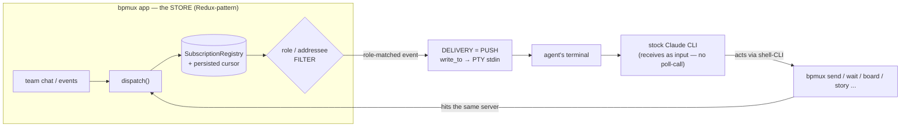

# bpmux Claude-independence — architecture

**Status:** SHAPING (2026-06-06). Delivery-model **LOCKED**: PUSH-via-injection — *derived* from Ryan's constraints (No polling + No Channels + keep the stock CLI + store/Redux), not a separate owner-confirm. See Decision-log + Open decisions.
**Epic:** [#1657](https://github.com/RyanDur/bpmux/issues/1657) · **First slice:** [#1656](https://github.com/RyanDur/bpmux/issues/1656)
**Authors:** PM (structure + decision-log) · dev (mechanism — VALIDATE/fill §Mechanism) · designer (agent-surface — VALIDATE/fill §Agent-surface)

## Goal

bpmux runs team-comms + agent-tooling on its OWN substrate — off Claude Code's experimental **Channels** feature (delivery) AND off **MCP** (tooling). Today the bridge IS a Claude Code Channel (research-preview; drops events silently; can be disabled), and all agent tooling rides MCP. This arc moves both onto **bpmux's own store + CLI**.

## Architecture (target)

Two halves, one store:
- **STORE = source-of-truth + routing** (Ryan's "Redux works at many layers"): the `SubscriptionRegistry` + `dispatch` already ARE a store; the **role/addressee FILTER** decides who-gets-what.
- **DELIVERY = PUSH the role-matched event into the agent's terminal** (`write_to` → PTY stdin). The agent passively RECEIVES (no poll-call) — this is what satisfies Ryan's **"No polling."**
- **TOOLING = `bpmux <verb>` shell-CLI** over the same server (replaces the MCP tools): `bpmux send` / `bpmux subscribe` / `bpmux board` / `bpmux story <n>`.

**Redux grounding (Ryan's reference 2026-06-06):** the store honours the three Redux principles — (1) single source-of-truth (one Store); (2) state mutated ONLY via dispatched **Actions** (`dispatch`); (3) pure **Reducers** compute next-state immutably. Subscribers react via the **Observer** pattern; actions are serializable **Commands**; the store is a **Singleton**; reducers select by action-type (**Strategy**). bpmux's existing `dispatch` + `subscribe` map onto this — dev grounds the reducer / state-shape in §Mechanism. The unidirectional cycle: agent acts (`bpmux <verb>` = dispatch Action) → reducer → store → role-filtered subscribers pushed (Observer) into terminals.

## Decision-log (why — so it doesn't re-thrash)

1. **PTY-injection** (first design) — write team-messages into the terminal stdin. Correct *mechanism*, but designed before grounding the store existed.
2. **Store-PULL via `wait_for_event`** (mid-session reframe) — agent subscribes role-filtered + pulls events. Channels-independent, but **ruled out by "No polling"**: the wait_for_event call→block→call loop IS a long-poll.
3. **Store-PUSH-injection (LOCKED 2026-06-06)** — reconciles both: the STORE dispatches + role-filters (Redux SoT + routing); DELIVERY pushes the role-matched event into the terminal via `write_to`. Push (not poll) into a stock CLI off Channels has exactly one mechanism = terminal stdin. The **misattribution-guard returns** (it's stdin again). Tonight's #1656 injection work + guard are NOT wasted.

> Actor-mailbox framing (designer research — Akka/Erlang, inbox/outbox pattern, arxiv MCP-comms survey 2506.05364): the **mailbox = the store**; the actor is **PUSHED** its mail, it does not poll. Events queue while the agent is busy (the registry channel is unbounded) + drain FIFO; persisted cursor + log-replay covers restart → no-miss.

## Mechanism (dev — VALIDATE / fill with code-anchors)

Grounded substrate (dev, firsthand — fill/correct):
- Store engine EXISTS: `subscribe`/`unsubscribe`/`wait_for_event` + dispatch + role-filter + persisted subscriptions/cursor — `bridge/event_subscription.rs`.
- Already dispatched as events: state-deltas + `addressed_to_me` — `connection.rs:257`.
- The Channels push to REMOVE — `connection.rs:242-256`.
- Push-into-terminal delivery — `LivePtyRegistry::write_to` (live_registry.rs:38-45) → `LivePty::write_input` (pty.rs:50-55) → PTY stdin. Green test: `registry_write_reaches_the_same_live_session_stdin`.
- The misattribution-guard (stdin-injection): marker `⟦bpmux⟧` + sender + scope, ANSI-framed; sanitize strips reserved-marker + all control/ANSI from the body (forgery structurally impossible); agent-setup frames marker-lines as PEER/untrusted, never owner-input. (designer spec: `terminal-injection-format-1656.md`.)
- `< dev: confirm the dispatch→role-filter→write_to wiring + the role↔terminal mapping for scoped delivery >`

## Slices + dependency-order

1. **Dispatch chat as events** (`broadcast_received`, mirror `addressed_to_me`) — common to push+pull. ~1pt. (dev building.)
2. **Push-delivery** — store dispatches → role-filter → `write_to` into the role-matched terminal + the misattribution-guard. (keystone)
3. **Remove the Channels push** (`connection.rs:242-256`) — the cutover, gated on 1+2 reliable.
4. **MCP→CLI re-homing** — every MCP tool → `bpmux <subcommand>`; PreToolUse gates → Bash-hooks. Bigger separable arc.
5. **Dispatch remaining event-classes** as-needed.

Order: 1 → 2 → 3; 4 after; 5 as-needed. **Aquila #1655** = the channels-off core (1+2+3). **MCP→CLI = next priority iteration** (Ryan: channels-independence iterations run before the others).

## Agent-surface (designer)

The agent's whole relationship to bpmux lives in its terminal — two directions, one plain-model surface; the owner watching the terminal sees ALL of it (nothing out-of-band).

**OUTGOING — the agent acts via `bpmux <verb>` commands** (replacing the MCP tools): `bpmux send` / `bpmux subscribe` / `bpmux board` / `bpmux story <n>`. Terminal-native; visible-by-construction (#1593's plain-model — actions read as normal terminal-content; mockup: `agent-actions-in-stream-1593-mockup.html`). This is the Observer→action half of the Redux flow: the agent dispatches actions to the store via the CLI.
- **Output-volume:** read-heavy commands (`bpmux board` / `story`) echo a COMPACT index-line (counts / one-line title), NOT the full dump; raw payload opt-in (`--full`). Keeps the stream readable — no 132KB flood. Same index-not-dump principle as the board-IA arc.
- **Gate-survival (falsifier-c — load-bearing):** the PreToolUse gates on the MCP tools today — filing-diagnosis-as-fix / pause-vocab / claim-class — MUST migrate to Bash-hooks on the `bpmux` commands. Don't trade the gating for independence.

**INCOMING — a pushed event arrives as a framed line in the terminal** (the delivery surface = the #1656 misattribution-guard, restored for stdin): `⟦bpmux⟧ {sender} {scope}▸ {body}` — ANSI-dim framing so the owner-watching distinguishes incoming-team from the agent's own work; the body is sanitized (reserved-marker + ALL control/ANSI stripped → forgery structurally impossible). Agent-setup frames `⟦bpmux⟧` lines as PEER / untrusted team-messages — attribute by sender, reply via `bpmux send`, NEVER owner-direct-input. (spec: `terminal-injection-format-1656.md`.)
- **Scope + no-leak by construction:** the store's role/addressee FILTER means only role-matched events are pushed to the agent — a scoped `to:[role]` message is pushed ONLY into that role's terminal, never broadcast-to-all.
- **Turn-gated (named tradeoff):** the pushed line is processed at the agent's next prompt-read, not mid-generation — no-poll but not instant. Mid-turn interrupt is the deferred future capability, not this epic.

So the terminal IS the whole interface: the agent acts via `bpmux` commands (visible) and receives team-events as framed-injected lines (guarded) — one stream, nothing hidden.

## Open decisions

- **PUSH-via-injection — LOCKED 2026-06-06.** Derived from Ryan's constraints (No polling + No Channels + keep the stock CLI + store/Redux), NOT a separate owner-confirm (Ryan: "I have given you my constraints"). The constraints settle it uniquely: no-polling → push (not the wait_for_event pull-loop); push into a stock CLI off Channels = terminal stdin = injection; the store role-filter = who-gets-pushed.
- **Turn-gated tradeoff (named, designer):** push-into-stdin is processed at the agent's next prompt, NOT mid-generation. No-poll but not instant. **Mid-turn immediacy** = a separate, harder "interrupt" capability — deferred (future arc), not this epic.

## Provenance

Shaped 2026-06-06 (Ryan + PM + designer + dev). Ryan: replace Channels + MCP with bpmux's own store + injected shell-commands; "redux is a pattern that works at many layers"; "No polling." This doc is the durable home so the architecture survives + the stories link to it.
