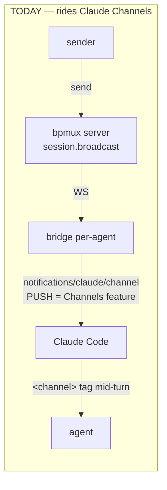
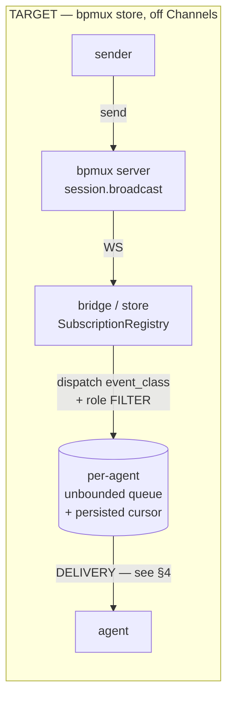
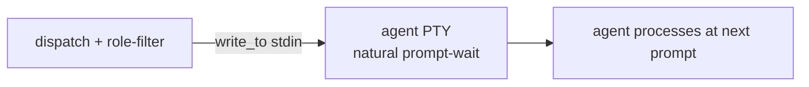
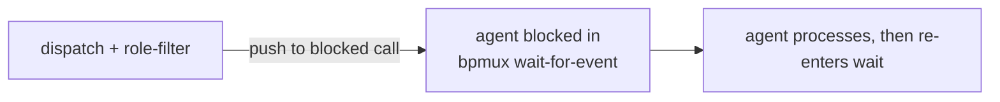

# Channels-Independence — Dev Technical Architecture

**Status:** DRAFT (shaping, 2026-06-06). Delivery-model **LOCKED: Option A — push-via-terminal-injection** (derived from owner constraints — see §4).
**Epic:** #1657 (bpmux Claude-independent). **First slice:** reshaped #1656.
**Companion docs (designer / UX):** `designer-ux-needs.md`, `terminal-injection-format-1656.md`, `agent-actions-in-stream-1593-mockup.html`.

This doc is the durable dev-side architecture so the design survives the session and the stories link to it. Substrate claims are firsthand-grounded with `file:line` anchors.

---

## 1. Problem

Team-messages reach an agent today via **Claude Code's Channels feature** — a research-preview that requires `--dangerously-load-development-channels`, is gated behind a `channelsEnabled` org policy, and **drops events silently** on failure. bpmux's entire team-comms substrate rides an experimental Claude-Code feature that can change or be disabled out from under it.

**Goal:** deliver team-messages (and, later, all agent↔bpmux tooling) on **bpmux's own store**, off Claude's Channels (delivery) and eventually off MCP (tooling).

---

## 2. The store (source of truth) — grounded, ~mostly built

bpmux already has a Redux-pattern store + dispatch: the **SubscriptionRegistry** (`applications/bpmux/src/bridge/event_subscription.rs`).

- `subscribe(event_class, filter)` → `subscription_id`; `filter` is matched against the event payload (`filter_matches`, event_subscription.rs:89) — **role/addressee filter = who-gets-what**.
- `dispatch(event_class, payload)` → fans the event to every matching subscription's channel (event_subscription.rs:217). The subscription channel is an **unbounded queue** (event_subscription.rs:123,171) → events QUEUE while the agent is busy; **no drop**.
- `wait_for_event(subscription_id, timeout)` → blocks on the subscription's receiver (`rx.recv()`), returns the event (event_subscription.rs:265).
- Subscriptions + a **persisted cursor** survive restart (`with_persistence`, event_subscription.rs:117) → no-miss across restart via cursor-replay.

**Already dispatched as subscribable events** (bridge, `connection.rs`): state-deltas — board/CI/sync/story-transition (connection.rs:116-171) — and `addressed_to_me` for directed messages (connection.rs:257-273).

**Gaps for channels-independence:**
1. ✅ **Broadcast chat dispatched as an event** — `broadcast_received` is dispatched alongside `addressed_to_me` (connection.rs), so broadcasts are subscribable via `wait_for_event` (slice 1, landed).
2. ✅ **The Channels push** (`notifications/claude/channel`) — REMOVED (slice 3). Agent delivery is terminal-injection; the bridge's `event_subscription` dispatch (`broadcast_received` / `addressed_to_me`, gated by the same `chat_relevance` filter) is the surviving MCP observation surface.
3. **The receive/delivery model** to the agent (see §4).

---

## 3. Message flow — current vs target

The store (dispatch + role-filter + queue) is the same in every option. **§4 is the only open variable.**

---

## 4. Delivery model — LOCKED: Option A (push-via-injection)

**Derived from the owner's constraints, not a fresh choice:** (1) *no polling* → delivery is PUSH, not pull; (2) the actor-mailbox is push-to-the-actor — the runtime DELIVERS into the mailbox + invokes the actor; `wait_for_event` (agent calls → blocks → re-calls) is long-polling = the polling ruled out; (3) push into a stock Claude CLI **off Channels** has exactly ONE mechanism — write into its terminal/PTY stdin; (4) the store's role-filter = who-gets-pushed. ⟹ **Option A.** Option B is recorded below as considered-and-ruled-out.

Both designs are **no-polling** and **keep the stock Claude CLI** (Carina's value); the constraints select A.

### Option A — Push-via-terminal-injection (store → write_to PTY stdin)

The server pushes a role-matched event into the agent's terminal via `LivePtyRegistry::write_to` (`live_registry.rs:38-45` → `pty.rs:50-55`; proven by `registry_write_reaches_the_same_live_session_stdin`). The agent receives it at its **natural prompt-wait** — the CLI already sits reading stdin — so the agent does **nothing** to receive (truly passive).

- ✅ Truly passive — leverages the CLI's inherent stdin-wait; **no agent receive-loop behavior** to depend on.
- ❌ Raw stdin → the **misattribution/forgery guard returns** (reserved-marker + sanitize-all-control/ANSI; see `terminal-injection-format-1656.md`).

### Option B — Pull blocking-inbox (`wait_for_event`) — CONSIDERED, RULED OUT

The agent ends its turn by calling `bpmux wait-for-event` (blocks); the server **pushes** the matched event into the blocked call (push-to-a-blocked-receiver, not interval-polling). This is the established multi-agent **inbox/outbox / actor-mailbox** pattern (Akka/Erlang; designer's research: mcp_agent_mail, AWS cli-agent-orchestrator, arxiv 2506.05364).

- ✅ **Structured** delivery (MCP tool-result / CLI stdout) — inherently attributed → no misattribution-guard.
- ❌ **RULED OUT:** the agent calling → blocking → re-calling `wait-for-event` IS long-polling = the polling the owner ruled out. (A true mailbox is push-to-the-actor, which is Option A.)

### Shared properties (both)
- **No-miss:** unbounded queue holds events while the agent is busy; persisted cursor replays across bridge-restart.
- **Turn-gated:** the agent reacts when it next finishes/waits, NOT mid-work. Mid-turn immediacy (like the old Channel push) is a separate, harder **interrupt** capability — out of scope here.
- **Scope + no-leak:** the role-filter determines who receives → a scoped `to:[role]` message reaches only that role; broadcast reaches all. Solves the no-leak privacy clause structurally.

### Decision: LOCKED → Option A
The owner's constraints (no-polling = push; mailbox = push-to-actor; off-Channels + stock-CLI ⟹ injection is the only push; store role-filter = recipients) **uniquely determine Option A** — store dispatches → role-filter → `write_to` the agent's PTY stdin, with the misattribution/forgery guard. #1656 reshapes onto this once (store-behind, injection-surface, guard restored). The injection format + guard already designed (`terminal-injection-format-1656.md`) are the delivery surface; the store sits behind it as the role-filtered source.

---

## 5. Slices (epic #1657)

| # | Slice | Depends on | Notes |
|---|-------|-----------|-------|
| 1 | **Dispatch broadcast-chat as a `broadcast_received` event** | — | Common to A and B. Mirror the `addressed_to_me` dispatch (connection.rs:257). Makes broadcasts subscribable. **Build now — model-independent.** |
| 2 | **Delivery = push-injection (Option A)**: store dispatch → role-filter → `write_to` PTY stdin + the misattribution guard | 1 | The keystone. Reshaped #1656. |
| 3 | ✅ **Remove the Channels push** (DONE) — deleted the `notifications/claude/channel` push + the `claude/channel` experimental capability + the now-dead `notification_meta`/write-only bridge `peer` field. Bridge chat reaches agents via terminal-injection; `wait_for_event` observes the subscription dispatch. Every channel-observing E2E test migrated to `wait_for_event`/`read_messages`; the `NotificationCapture` harness retired. | 1+2 | Completed "channels-off" (code). Launch-flag `--dangerously-load-development-channels` in the README/`agent-terminal-launch.md` runbook is now a no-op for the channel capability — drop it after verifying the bridge still loads project-scoped without it (separate, needs a live relaunch). |
| 4 | **MCP→CLI re-homing** | 3 | Separable, bigger arc. Every MCP tool → `bpmux <subcommand>` over the server; PreToolUse gates → Bash-hooks. Later iterations. |

---

## 6. Open risks / notes
- **Identity mapping (A only):** terminals are keyed by a random UUID (`rest/room.rs:26`), agent named `agent-<uuid8>` — no role assignment. Push-injection to a *role* needs a role↔terminal map; the store's **subscription/role-filter supplies it** (the agent subscribes under its role). Confirm at slice-2.
- **Receive-loop reliability (B only):** frame `bpmux wait-for-event` as the agent's **sole input-path** (its inbox) in agent-setup so it's the natural cycle, not a remembered chore.
- **Gate-migration (slice 4):** the PreToolUse filing/pause-vocab/claim-class gates on MCP tools must re-home to Bash-hooks on the `bpmux` CLI — migrate, don't drop.
