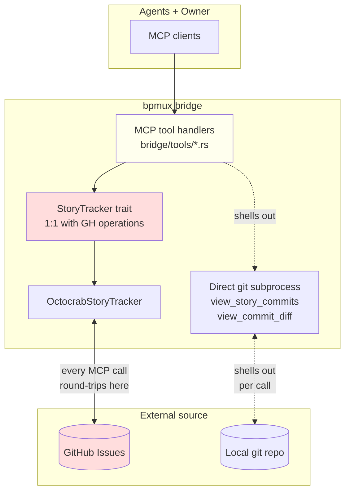
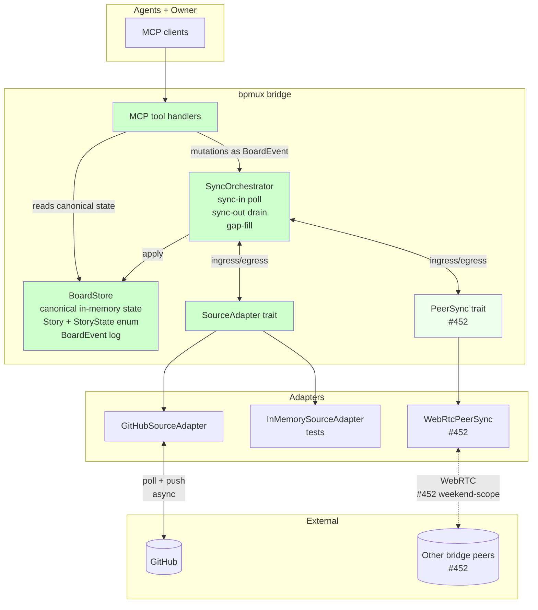

# #451 internal board abstraction — current vs proposed

Companion to `08-internal-board-abstraction.md`. Mermaid diagrams
rendering the same architecture the spec describes in prose.

## Current state (pre-#451)

**Problems visible in this shape**:

- Every MCP call round-trips to GH (or shells git) — latency per call + coupling + rate-limit exposure.
- Two separate direct-to-source paths (tracker + git-subprocess) each with their own failure modes: #411 / #412 git-subprocess CWD, #450 label-stale from label-order-priority state-derivation.
- `StoryTracker` trait leaks GH 1:1 into domain names.
- No canonical internal state. Labels drive state — the source of #450.
- GH-down = bridge-effectively-down.

## Proposed state (post-#451, with #452 peer-sync layered in)

**What this shape wins**:

- MCP handlers only touch `BoardStore` + `SyncOrchestrator` — zero direct source coupling.
- Canonical in-memory state; reads are instant, writes are `BoardEvent`.
- Source + peers are symmetric ingresses of `BoardEvent` into `BoardStore` (hexagonal orthogonality — `SourceAdapter` and `PeerSync` are peers, not layered).
- GH-down doesn't break bridge; `SyncOrchestrator` retries async; `BoardStore` serves last-known-good.
- Peer-sync (#452, weekend-scope) adds multi-peer without reshaping any #451 code.
- Retires #450 (label-stale class) — typed `StoryState` enum replaces label-order-priority derivation.
- Retires tracker's direct octocrab seams — eliminates #411/#412/#447 class.

Green nodes = new in #451. Light-green node (`PeerSync`) = layered in #452.

## Current migration position

- **Phases 1–3** shipped: domain + `BoardStore` + `SourceAdapter` trait + `InMemorySourceAdapter` + `GitHubSourceAdapter` + `SyncOrchestrator`.
- **Phase 4a** shipped: `BridgeServer` holds `Arc<BoardStore>` alongside tracker.
- **Phase 4b** shipped: `run_bridge` seeds `BoardStore` from tracker at startup; first handler (`list_ready`) reads from board.
- **Phase 4c–4z** pending: one-at-a-time handler migrations from `StoryTracker` → `BoardStore` + `SyncOrchestrator`.
- **Phase 5** pending: delete `StoryTracker` trait + `FakeTracker` + `OctocrabStoryTracker` once every handler is on board.

Today the bridge still uses tracker for most handlers; substrate is live alongside and ready to absorb them.
