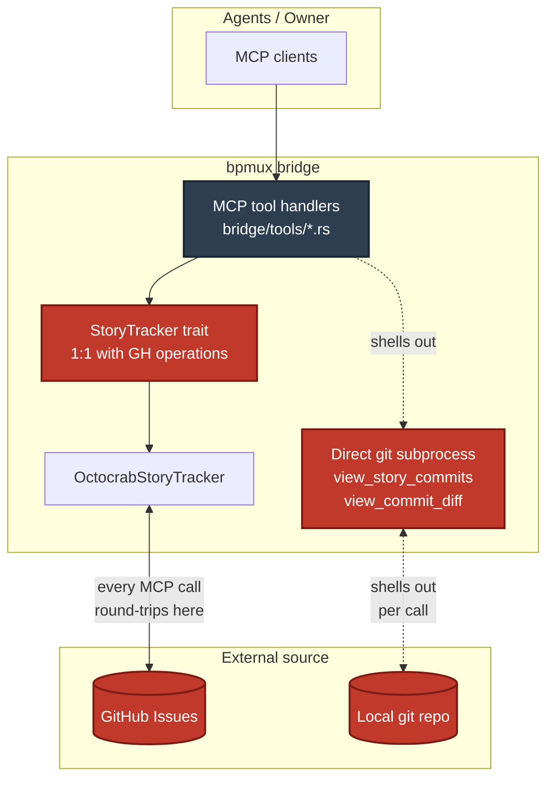
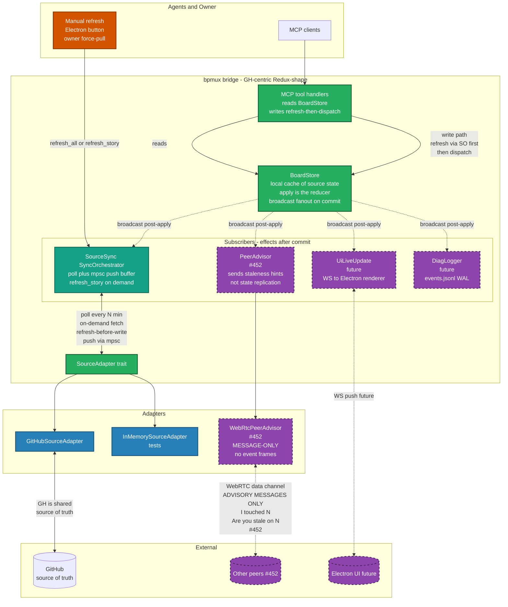
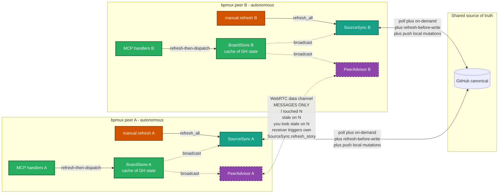

# phase-1b internal board abstraction (#451 — source-swappable board)

Ryan 2026-04-24 13:21 UTC: *"your board mcp functions should not be
checking github issues. they should be checking our internal board.
github issues should be feeding our board. if we decide to move to a
different project board source, that should not affect how you see
your work."*

13:23 UTC: *"also, your changes to the board should push a change to
the source. if a change does happen to the source, that should still
be reflected on the board."*

Today's bug class traces to a single architectural seam: GitHub is the
direct source-of-truth for every MCP tool that reads or mutates board
state. Each incident stacks on the seam —

- **#411 / #412 / #447**: git subprocess resolving refs fails because
  the bridge process isn't in the repo CWD. Root is the MCP handler
  shelling out directly to git.
- **#450 (deliver_story label-stale)**: `remove_label` silently
  fails when GH returns an error; local state has no authoritative
  position so stale labels persist; the state derivation reads from
  the stale label set. Root is no internal state-of-truth — each
  call-site re-reads GH directly.
- **#446 (scope-filter hides sends from owner)**: architectural
  invariant couldn't be expressed purely in the send-machinery layer
  because scope-filter semantics were entangled with a separate
  delivery-state concern. Root is conflating transport + filtering
  + scope without a domain boundary.
- **Accept-lane drift**: pm's present-to-ryan messages reconstruct
  gate-history via `view_story_timeline` (#418) which itself reads
  GH comments. Any direct-read of GH multiplies the seams.

One architectural reshape closes the entire class. The internal board
becomes the canonical state; GitHub becomes a sync-source (feed +
push); MCP tools read + write against the internal state, never GH
directly.

## 3-field spec header

**user-job:** When any agent queries or mutates board state via an
MCP tool, the operation returns canonical internal state + writes
to canonical internal state — regardless of whether the underlying
project-board source is GitHub, Linear, a self-hosted tracker, or an
in-process mock. Source changes propagate to the board asynchronously
without requiring MCP-tool changes. Local mutations propagate to the
source asynchronously without requiring the caller to wait on the
source.

**observation-falsifier:** I would reject if:
- Any MCP tool handler calls `octocrab`, shells out to `git`, or
  otherwise talks to GitHub directly rather than through the board
  domain layer
- Local mutations don't propagate to the source (source falls out
  of sync silently)
- Source changes don't propagate to the board (board falls out of
  sync silently)
- Swapping the source adapter (e.g. GitHub → in-memory mock)
  requires modifying any MCP tool handler
- A local mutation that fails to push to source leaves the local
  state in an inconsistent read-after-write state
- Sync-layer failures aren't observable to the team (silent
  background failures of the "GH returned 500" class)

**team-shape-independence:** the domain model MUST NOT name
"GitHub" anywhere in its type signatures — no `GhIssue`, no
`octocrab::models::*`, no GitHub-flavored JSON keys leaking through.
Today's `StoryTracker` trait leaks this (method names map 1:1 to GH
operations; return values are GitHub JSON strings). The reshape
renames the seam structurally.

## Architectural shape

### Current (pre-#451)



**Leaks visible**: every MCP call round-trips to GH or shells git; two
direct-to-source paths (tracker + git-subprocess) each with their own
bugs (#411 / #412 / #447 CWD; #450 label-stale); StoryTracker names
GH operations 1:1; no canonical internal state; GH-down = bridge-
effectively-down.

### Proposed (post-#451, with #452 layered)



**Reading the GH-centric + Redux shape** (per Ryan 2026-04-24 18:24
+ 18:29 UTC directions):
- **GitHub is the shared source of truth**, not peer-replicated state
- **Each peer's BoardStore is a local cache** of GH state + its own
  in-flight mutations; not an authoritative replica
- **Write path is refresh-then-dispatch** — every mutation handler
  calls `SyncOrchestrator.refresh_story(N).await` before dispatching
  the BoardEvent; prevents stale-local-state from driving bad writes
- **WebRTC peer channel carries MESSAGES ONLY** — staleness
  advisories ("I touched #N" / "Are you stale on #N?" /
  "You look stale"), never BoardEvents as state-carrying frames
- **Manual refresh button** (owner control, orange in diagram) — lets
  Ryan force-pull from source at any time; wired to SourceSync's
  refresh primitive
- **Subscribers symmetric** — source-sync pushes upstream; peer-advisor
  sends hints; future UI re-renders; future logger writes WAL; all
  observe the same broadcast channel

### Symmetric peers (future #452 topology) — GH-centric + advisory

Each bpmux runs the same code. Two peers look like mirror images,
each owning its own GH sync + its own BoardStore cache. They contact
each other for STALENESS HINTS ONLY — never relay BoardEvents or
replicate state between themselves.



**Reading the GH-centric + advisory shape**:
- Both peers hit GH independently — GH is the shared source-of-truth,
  not peers replicating each other's state
- WebRTC carries ADVISORY MESSAGES ONLY (never BoardEvents): peer-A
  tells peer-B "I touched #N"; peer-B chooses whether to refetch
- No CRDT / no LWW-tiebreak needed — GH's commit order is the
  authority; peers re-pull to reconcile
- No loop-prevention needed — PeerAdvisor doesn't relay received
  advisories onward; it just calls local SourceSync.refresh_story(N)
- Weekend-test scenario: work-laptop + home-machine; each polls GH
  on its own schedule; when Ryan manually edits a story via GH web
  UI on work-laptop's bpmux, that peer pushes to GH + advises the
  home-machine's peer; home-machine refreshes the affected story
  from GH
- If WebRTC drops: degrades gracefully to polling-only (no
  advisory-hints; stale-detection slower; still works)

**What the proposed shape shows**: MCP handlers only touch BoardStore
+ SyncOrchestrator; canonical in-memory state; reads are instant,
writes are BoardEvents; source + peers are symmetric ingresses (both
are just BoardEvent-in); GH-down doesn't break bridge (SyncOrchestrator
retries async); PeerSync (#452) layers on without reshaping any #451
code.

### ASCII-fallback of the proposed shape

Hexagonal / ports-and-adapters:

```
┌──────────────────────────────────────────────────────┐
│  MCP TOOLS LAYER                                     │
│  get_story, list_ready, view_story_timeline,         │
│  create_story, label_story, close_story, etc.        │
│                  │                                   │
│                  ▼                                   │
│  BOARD DOMAIN (canonical state + mutations)          │
│  - Story, Comment, Column, Label (domain types)      │
│  - BoardStore (read/write against the canonical)     │
│  - BoardEvent (mutation log for sync-out)            │
│                  │            ▲                      │
│                  ▼            │                      │
│  SOURCE-SYNC PORT (trait)                            │
│  - ingest_from_source() -> Vec<StoryUpdate>          │
│  - push_event_to_source(BoardEvent) -> Result<_, _>  │
│  - observe_source_changes() -> Stream<StoryUpdate>   │
│                  │            ▲                      │
│                  ▼            │                      │
│  ADAPTERS (one per source)                           │
│  - GitHubSourceAdapter (octocrab + git-log)          │
│  - InMemorySourceAdapter (for tests)                 │
│  - (future: LinearSourceAdapter, etc.)               │
└──────────────────────────────────────────────────────┘
```

**Ingress** (source → board): on bridge start + on periodic poll +
on webhook-push-if-available, the sync layer calls
`ingest_from_source()` on the adapter, gets a diff of source state
vs board state, applies the diff to `BoardStore`. Failure to ingest
logs to `diag` + retries; board keeps serving its last-known good
state.

**Egress** (board → source): MCP tool mutations go through
`BoardStore.mutate(...)` which (1) updates canonical state
synchronously, (2) enqueues a `BoardEvent` to a sync-out buffer.
A background task drains the buffer, calling
`push_event_to_source(event)` on the adapter. Failures reappend with
backoff + surface to `diag`. The MCP tool caller sees immediate
local success; source-sync completes eventually.

**Conflict resolution (MVP)**: last-writer-wins per field. A
background reingest-pass reconciles any drift by overwriting board
state with source state where they disagree on a per-story-field
basis. Future-sharpening can add field-merge policies (see Out of
scope).

## Domain model sketch (Datensparsamkeit-shaped)

Ryan 2026-04-24 14:04 UTC pointed at Martin Fowler's
[Datensparsamkeit](https://martinfowler.com/bliki/Datensparsamkeit.html)
as the shaping principle. The domain must store only what MCP
handlers actually consume — every field justified by a concrete read.
Capture-everything mirrors are the anti-pattern here.

**Field audit — what current MCP handlers actually read**:

| Field                  | Consumer MCP tool(s)                      | Keep? |
|------------------------|-------------------------------------------|-------|
| number                 | all read tools                            | ✓     |
| title                  | list_ready / view_board / get_story       | ✓     |
| body                   | get_story (+ rework_context enrichment)   | ✓ (lazy) |
| state                  | all read tools; gate transitions          | ✓ (typed enum) |
| filed_at               | view_story_timeline (filed gate event)    | ✓     |
| filed_by               | view_story_timeline actor                 | ✓ (short-form) |
| gate_comments          | view_story_timeline / rework_context      | ✓ (structured) |
| free_comments          | view_comments                             | ✓ (lazy) |
| labels (raw)           | — (only used to derive state)             | ✗ (replaced by enum) |
| created_at / updated_at on Story | — (not surfaced to any handler) | ✗     |
| author profile / assignees / milestones / reactions | — (unused) | ✗     |
| html_url / gh-specific JSON keys | — (also violates team-shape-independence) | ✗     |
| Comment.id             | — (never surfaced; ordering via ts)       | ✗     |

```rust
// bpmux/src/board/domain.rs
pub struct Story {
    pub number: u64,
    pub title: String,
    pub state: StoryState,
    pub is_closed: bool,                   // archived at source; orthogonal to state (see Close-as-action shape below)
    pub filed_at: chrono::DateTime<chrono::Utc>,
    pub filed_by: String,                  // short-form, no full GH profile
    pub body: Option<String>,              // lazy-populated on first get_story
    pub free_comments: Option<Vec<FreeComment>>,  // lazy-populated on first view_comments
    pub gate_comments: Vec<GateComment>,   // eager-ingested (small, timeline-load-bearing)
}

pub enum StoryState {
    Icebox, Ready, InProgress, Delivered,
    ReadyForAccept, NeedsFixes, Rejected, Accepted,
}

pub struct GateComment {
    pub gate: Gate,
    pub ts: chrono::DateTime<chrono::Utc>,
    pub actor: String,
    pub payload: Option<String>,  // Some for Pickup/Delivered/Rejected/FailDeskCheck
}

pub enum Gate {
    Filed, Pickup, Delivered,
    PassDeskCheck, FailDeskCheck,
    Rejected, Accepted,
}

pub struct FreeComment {
    pub body: String,
    pub author: String,           // short-form
    pub ts: chrono::DateTime<chrono::Utc>,
}

pub enum BoardEvent {
    StateTransition { story_number: u64, new_state: StoryState, actor: String, ts: chrono::DateTime<chrono::Utc> },
    GateCommentAppend { story_number: u64, gate: Gate, actor: String, payload: Option<String>, ts: chrono::DateTime<chrono::Utc> },
    FreeCommentAppend { story_number: u64, body: String, author: String, ts: chrono::DateTime<chrono::Utc> },
    StoryCreate { title: String, body: String, author: String, ts: chrono::DateTime<chrono::Utc> },
    StoryClosed { story_number: u64, reason: Option<String>, actor: String, ts: chrono::DateTime<chrono::Utc> },
}
```

Notable shifts from capture-everything:

- `StoryState` is the typed enum; raw labels never appear in domain
  types. The source-adapter encodes/decodes labels ⇄ state at the
  seam.
- `body` and `free_comments` are `Option<_>` — the startup ingest
  only populates metadata + gate_comments; body + free-comments
  lazy-load on their first read. Memory grows with the active
  working-set, not with the full repo history.
- `gate_comments` stay eager (small, required for timeline without
  per-call GH round-trip).
- `BoardEvent` log stores deltas (field + new-value), not full
  story-snapshots. Smaller WAL, smaller replay cost.
- No author-full-profile, no html_url, no reactions — less privacy
  surface if dev ships the `~/.bpmux/` WAL later.

Impact on earlier cons (updated with Spike 1 + Spike 2 empirical
numbers 2026-04-24 15:07 / 15:31 UTC):

- **Memory cost**: Spike 2 measures typical working-set at 40 stories
  in a peak 30-min window, 92 distinct across a full session (~20% of
  450-story corpus). Fully-loaded working-set ≈ 2MB; metadata-only
  mirror for all 450 ≈ 400KB. Total well under 5MB even at 10x scale.
- **Conflict resolution**: fewer fields to conflict on (title / body
  / state are the realistic candidates; comments append-only).
- **Startup latency**: Spike 1 measured serial eager-ingest at 18s
  (6x the original 3s target) — pure-eager is infeasible. Revised
  startup: metadata + gate_comments only, with parallel pagination,
  targeted at <1s. Body + free_comments lazy-populate on first read
  (~200-400ms cold path per story, warm after).
- **Hot-set dominance (new, from Spike 2)**: top-15 stories = ~50% of
  all references in a session. Lazy-load amortizes body + free_comments
  cost across natural working-set; ~80% of the corpus never touched
  in any given session would be wasted bandwidth on eager-mirror.

Eager-mirror's "works offline regardless of source" guarantee
weakens for uncached body/free_comments — an uncached body read
against a down source returns a source-unreachable error. For
bpmux's measured working-set (hot-set dominated; teammates repeatedly
touch the same 15-40 stories), cache warms within the first few
minutes of a session; source-down-post-warm stays functional for the
active set. Tradeoff is acceptable + explicit.

## Sync-layer port

```rust
// bpmux/src/board/sync.rs
#[async_trait]
pub trait SourceAdapter: Send + Sync {
    async fn ingest_all(&self) -> Result<Vec<Story>, SyncError>;
    async fn push_event(&self, event: &BoardEvent) -> Result<(), SyncError>;
    async fn observe_changes(&self) -> Pin<Box<dyn Stream<Item = StoryUpdate>>>;
}
```

`observe_changes` is optional — adapters that don't support push
notifications fall back to polling via `ingest_all`. GitHub's
webhook surface is out-of-scope MVP; poll at 60s interval for MVP.

## Migration path (existing callers)

`StoryTracker` trait today is the de-facto abstraction boundary.
Every MCP tool handler takes `&impl StoryTracker`. The reshape:

1. Replace `StoryTracker` with `BoardStore` at every tool handler
   callsite. Handlers now call e.g. `store.story(number)` /
   `store.mutate(event)` instead of `tracker.get_story(number)` /
   `tracker.add_label(number, label)`.
2. Reimplement `GitHubSourceAdapter` using the existing octocrab
   code (from the current `OctocrabTracker` impl) — this becomes
   the sync-adapter, not the direct-query-path.
3. Introduce `BoardStore` as an in-memory struct keyed by story
   number, with `RwLock` for concurrent reads + serial writes.
4. Stand up the sync-out buffer (tokio::mpsc::channel) + background
   drain task; retry-on-failure with exponential backoff.
5. Stand up the ingest poll-loop: every 60s, call
   `adapter.ingest_all()`, diff vs current store, apply updates.
6. Per-tool migration: each tool handler's test suite swaps from
   `MockStoryTracker` to `InMemoryBoardStore` — same test-shape,
   cleaner construction.

Dev can sequence the migration per-tool; the `StoryTracker` trait
can coexist with `BoardStore` during transition (both implement the
same read shape; migration is a per-handler swap).

## Pattern-lens: Redux / Flux / Elm architecture

Ryan 2026-04-24 18:08 UTC named the underlying pattern. #451's
architecture maps directly onto Redux's three principles:

| Redux concept | #451 implementation |
|---|---|
| Single Source of Truth (Store) | `BoardStore` — canonical in-memory state keyed by story number |
| State is Read-Only (Actions) | `BoardEvent` — the only way to change state |
| Pure Reducers | `BoardStore.apply(&BoardEvent)` — no side effects; pure state transition |
| Middleware | `SyncOrchestrator` — intercepts events, pushes to source-sync-out buffer, then applies |
| Subscribe / listeners | `BoardSubscriber` trait (see next section) |

Dev proposal 2026-04-24 18:09 UTC concretizes the extensibility
point that was implicit: effects other than source-sync (peer-sync,
UI live-updates, diagnostic logging) become first-class subscribers
rather than embedded middleware.

## Subscribers / Effects

```rust
// bpmux/src/board/store.rs — additive to BoardStore
impl BoardStore {
    pub fn subscribe(&self) -> broadcast::Receiver<BoardEvent> { /* ... */ }
}
```

`BoardStore` holds a `tokio::sync::broadcast::Sender<BoardEvent>`
internally; every `apply()` call publishes to the channel AFTER the
state transition commits. Consumers call `subscribe()` to get a
`Receiver`, which they drain in their own task. Lagged / closed
receivers handled via existing broadcast semantics (log + drop; no
back-pressure onto the Store). Per dev's Phase 4d shipped shape
(2026-04-24 18:09 UTC).

Effect decomposition (each is a separate subscriber task):

- **SourceSyncSubscriber** — pushes the event onto the sync-out
  buffer (becomes THE sync-out buffer owner; no longer implicit inside
  SyncOrchestrator). Source poll-task ingress remains an orthogonal
  path into `BoardStore.apply()`.
- **PeerSyncSubscriber** — #452 adds this. Serializes event + sends
  to connected peers via WebRTC. Same trait, different effect.
- **UiLiveSubscriber** — future. Electron renderer subscribes via
  WS; get_sync_status + board-refresh become push-driven rather than
  poll-driven.
- **DiagnosticSubscriber** — future. Writes events to `~/.bpmux/
  board-events.jsonl` WAL for crash recovery + audit.

This matches the Observer + Command + Mediator patterns (per the
Redux design-pattern analysis): subscribers observe; events are
commands; BoardStore mediates.

Notably it makes SOURCE-SYNC AND PEER-SYNC SYMMETRIC (sibling
subscribers, not layered). Today's design had source as primary and
peers as a follow-up layer on top. The Redux-lens realigns them
both as *effects* triggered by local state-transitions.

**Channel vs buffer — two different egress mechanisms**: dev's
Phase 4d choice keeps BOTH:
- `broadcast` channel (best-effort fanout) for reactive listeners
  (UI live-refresh, peer-sync, diagnostic logging) — lagged-receiver
  drops the lagged events with a log-line
- `mpsc` channel (ordered, guaranteed-delivery) for sync-out buffer
  (source-push) — ordering matters for GH pushes (e.g., AddLabel
  before RemoveLabel on same story)

The subscriber trait isn't one size fits all — broadcast fits
at-least-listeners-get-notified; mpsc fits must-not-drop-ordered.
SyncOrchestrator continues to own the mpsc sync-out buffer for
source-push; it ALSO consumes the broadcast channel (as a subscriber)
for its status observability. Future subscribers choose their shape
based on their effect's reliability requirement.

`SyncOrchestrator` remains the facade holding the sync-out buffer,
poll task, and SyncStatus observability. Mutate-dispatch entry-point
stays at `SyncOrchestrator.mutate()` during migration window for
API stability; future cleanup can move dispatch to
`BoardStore.dispatch()` once all handlers migrate.

## P2P-friendly invariants (future-consideration scope)

Ryan 2026-04-24 15:04 UTC: single-peer scope today, P2P distributed
team as a future consideration. #451 ships single-peer abstraction
with three invariants that make a future peer-sync story additive,
not a rewrite.

**Invariant 1 — BoardEvent is the sole mutation path.**
No direct field-writes on `BoardStore` outside of event application.
All state changes flow through `BoardStore.apply(event: BoardEvent)`.
This makes the event-log the authoritative history for future
peer-sync.

**Invariant 2 — BoardEvent carries `(actor, ts, peer_id)`.**
`peer_id: PeerId` is present in every event's metadata. MVP uses a
single constant (`PeerId::local()`) — effectively a no-op today.
Future peer-sync story distinguishes peers without reshaping the
event schema.

**Invariant 3 — Last-writer-wins uses `ts`, then `peer_id` as
deterministic tiebreak.**
Concurrent conflicting events resolve by `max(ts)` first; ties
broken by `peer_id` lexical ordering. This is CRDT-compatible (all
replicas independently compute the same winner). Today with one
peer, ties are impossible, so the rule is vacuous. The shape doesn't
need a rework when peers multiply.

**Loop-prevention via peer_id (implicit until #452)**:
Every bpmux peer runs the same code — same BoardStore, same
reducer, same subscriber pattern. When #452 peer-sync ships, a
naïve relay would loop: peer A dispatches event E → A's PeerSync
relays to B → B applies E → B's subscribers fire → B's PeerSync
would try to relay E back to A.

Solution baked into EventMeta.peer_id: PeerSync subscriber only
relays events where `event.meta.peer_id == PeerId::local()`. Events
received from peers carry the originating peer's id; the check
treats them as "already-relayed, don't re-send." Same pattern as
gossip-protocol flood-prevention.

Single-peer (#451 scope) has only `PeerId::local()` — the check is
vacuous. But the field is present + #452's loop-break logic has a
stable hook to attach to without reshaping events.

**Invariant 4 — `mutate_sync` is sequential, not atomic.**
Multi-event handlers (accept_story emits 4 events; reject_story emits
3; close_story emits 1; etc.) call `mutate_sync` sequentially. If
event N fails (e.g., pending-buffer closed at shutdown) after events
1..N-1 succeeded, the local store is in a partial-mutated
intermediate state.

Recovery paths:
- (a) refresh-before-write on next mutation re-syncs from source —
  AC 11 already enforces this for every mutation handler
- (b) full reingest on restart re-syncs the store from source-of-
  truth via `decode_story_metadata` + `is_closed` durability

Bounded today: single-peer scope; pending-buffer close is shutdown-
only; recovery paths absorb the partial-mutation case before any
user-visible consequence.

Promotion to atomic-batch primitive (e.g., `mutate_batch` /
`atomic_mutate_sync`) when EITHER:
- (i) a real partial-mutation incident occurs in production with
  user-visible consequence, OR
- (ii) a new consumer surfaces that needs atomic-multi-event-
  semantics (P2P/CRDT replay; cross-peer event-frame batching;
  similar)

Until either trigger fires, the sequential-not-atomic shape is
documented and accepted.

**Adjacent migration tax on these invariants**: small. MVP stamps
events with `PeerId::local()` at enqueue; the tiebreak rule is a
3-line function. Dev's proposal 2026-04-24 14:10 UTC frames these as
"doesn't preclude" rather than "actively supports" — future P2P
story still does the peer-sync work itself.

**What's explicitly out-of-scope for #451**:
- WebRTC peer-sync transport (use existing `transport/webrtc.rs`
  substrate in the follow-up)
- Divergence-visibility UX (which peer is behind whom)
- Offline-merge UX (conflict resolution when a peer returns after
  missing events)
- Authority-asymmetry rules (owner vs agent authority on
  accept/reject when peers disagree)
- CRDT field-merge policies beyond LWW-per-field

These become the follow-up story's scope once single-peer lands.

## Close-as-action shape (close_story migration)

`Rejected` is a team-deliberation-pending state per Ryan 2026-04-25:
"rejected means the team will decide what they need to do with it"
(rework / close-as-won't-fix / defer). Rejected stories stay open at
the source so the team can act on them.

Owner-driven `close_story` is semantically distinct: "owner says this
story is finalized; team won't act further." That's an
**archive action**, not a state transition — the story preserves its
last domain state (Delivered / InProgress / etc) while the source
issue closes. This matches the operator's PT mental model where
won't-fix = delete/archive (an action), not a state.

Mechanism:

- **`BoardEvent::StoryClosed { story_number, reason, actor, ts }`** —
  the archive event. Carries optional reason text for the
  "why we're closing" comment at the source.
- **`Story.is_closed: bool`** — set to true by
  `BoardStore::apply(StoryClosed { .. })`. Story state is preserved.
  View-layer combines `state` + `is_closed` to filter
  closed-not-accepted stories from active buckets.
- **`accept_story` emits StoryClosed alongside StateTransitioned{Accepted}**
  (4 events: TagRemoved + GateCommentAppended + StateTransitioned + StoryClosed).
  Adapter drains StateTransitioned{Accepted} as label-add only;
  StoryClosed closes GH issue. Decouples close-from-state-transition.
- **`close_story` emits StoryClosed only** (no state transition).
  Story preserves last domain state in BoardStore; `is_closed = true`
  signals archive.
- **Adapter drain on StoryClosed**: optionally appends `reason` as a
  free comment (when Some), then calls `inner.close_story` —
  idempotent via `is_already_closed_error`.

Why not a 9th `StoryState::Closed` variant: the StoryState enum is
locked at 8. Adding Closed as a state would conflate actor-finality
(owner-closed terminal) with team-deliberation-pending (Rejected) at
the same axis; treating close as an orthogonal action keeps the
state-machine size unchanged and the actor-finality distinction
derivable from `(state, is_closed)`.

Why not reuse `StateTransitioned{Rejected}`: Rejected is
team-deliberation-pending and intentionally stays open at source;
closing GH on Rejected would break that semantic.

## Acceptance criteria

1. A new `BoardStore` type exposes the canonical read + mutate API;
   every existing MCP tool handler in `bridge/tools/` reads + writes
   through it. Zero handlers call `octocrab` or shell out to `git`
   directly after this story lands.
2. A new `SourceAdapter` trait abstracts source operations; the
   existing octocrab code is moved behind `GitHubSourceAdapter` as
   the first impl.
3. Local mutations via MCP tool handlers update `BoardStore`
   synchronously and enqueue a `BoardEvent` to the sync-out buffer.
   The tool returns success immediately — caller doesn't block on
   source push.

   **Exception — identity-establishing creation**: `create_story`
   synchronously blocks on the source-assigned identity (the new
   story number) since the caller depends on it; the BoardEvent
   `StoryCreated { number: u64, ... }` carries the assigned number
   as a non-Option field, making the sync round-trip the only
   coherent shape. State-mutations on existing stories follow the
   fire-and-forget pattern above.
4. A background sync-in task polls the source every 60s (configurable
   via env) and applies diffs to the store. A background sync-out
   task drains the buffer, pushing events to the source, with
   retry-with-backoff on failure.
5. Source-sync failures emit to `diag` + are observable via a new
   `mcp__bpmux-bridge__get_sync_status()` tool (returns
   {last_ingest_at, last_push_at, pending_events, last_error}). No
   silent drop-on-floor.
6. The domain model type signatures contain zero GitHub-flavored
   names (`GhIssue`, `octocrab::*`, JSON keys like `html_url`).
   `StoryState` is a typed enum, not a string.
7. An end-to-end test seeds `InMemorySourceAdapter` with 3 stories,
   calls `create_story` / `label_story` / `close_story` via the MCP
   handlers, asserts (a) the store reflects the mutations, (b) the
   adapter observes the pushed events.
8. **`StoryTracker` references are deleted from the bridge handler
   layer** (`bridge/tools/`, `bridge/tools_stories.rs`, `BridgeServer`)
   per `feedback_replace_story_includes_delete`. No dual-layer
   lingering at the bridge boundary — handlers read/write through
   `BoardStore` + `SyncOrchestrator` only.

   **Intentionally retained scope** (per migration-path step 2):
   `GitHubSourceAdapter` wraps `OctocrabStoryTracker` as its source-
   adapter implementation; `transport/rest.rs` and
   `transport/ci_watcher.rs` retain `StoryTracker` for their own
   concerns. The trait + `OctocrabStoryTracker` impl survive #451 as
   adapter-internal scaffolding and non-bridge consumers. Migration
   of those non-bridge callers (if ever needed) is a separate
   follow-up story, not in #451's scope.

   Per Ryan 2026-04-25 03:24 UTC + downstream team-convergence: the
   bridge-board abstraction goal is "MCP tool handlers don't talk
   to GitHub directly," not "delete every line of tracker code in
   the repo." This AC closes the former, not the latter.
10. `BoardStore` exposes a `subscribe() -> broadcast::Receiver<BoardEvent>`
    method. Every `apply()` publishes to the channel post-commit.
    At least one subscriber exists at startup (the SyncOrchestrator's
    status-observer). Future subscribers (peer-sync #452, UI
    live-refresh, diagnostic logging) register via the same API
    without BoardStore changes.

11. **Refresh-before-write on mutations** (per Ryan 2026-04-24
    18:24 UTC). `SyncOrchestrator` exposes `refresh_story(N: u64)`
    and `refresh_all()` primitives that pull from source, diff
    against the local cache, and apply update-deltas to BoardStore.
    Every mutation-handler (tools_stories.rs: create_story,
    label_story, accept_story, reject_story, pass_desk_check,
    fail_desk_check, close_story, etc.) calls `refresh_story(N)`
    before dispatching its BoardEvent. Prevents stale-local-state
    from driving bad writes when another peer has edited the same
    story via the shared source. Write-path latency rises (~200-400ms
    for source round-trip) vs read-path unchanged; acceptable for
    interactive usage where mutations are human-cadence.

    **Source-unreachable handling** (per Ryan 2026-04-24 18:43 UTC —
    option a block-plus-fail-fast; polling reconciles on source
    recovery): if `refresh_story(N)` times out (e.g., 5s) or returns
    a source-error, the mutation-handler FAILS FAST with a
    clean error surfaced to the MCP caller (e.g., "source
    unreachable: GitHub returned 503; try again when back or use
    manual refresh"). No queue-and-retry; no ghost-writes. Polling
    continues in the background; when the source recovers, the
    next polling tick restores the mirror + subsequent mutations
    succeed normally. Electron surfaces a visible source-down
    indicator (derived from SyncStatus.last_error + elapsed-since-
    last_ingest_at) so the owner knows WHY writes are failing.

9. Bridge-startup behavior (informed by Spike 1 2026-04-24 15:07
   UTC — serial eager-ingest measured at ~18s for current scale,
   6x the original 3s target). Revised startup shape:
   - On startup, `BoardStore` is empty. The sync-in task runs
     immediately with PARALLEL pagination, fetching story-metadata
     + gate-marker comments ONLY (title, state, filed_at, filed_by,
     gate_comments — no body, no free_comments).
   - Metadata-ingest target: **<1s for ~450 stories** with parallel
     pagination (Spike 1 projects this holds; confirm in e2e test).
   - `body` and `free_comments` populate lazily — each
     `get_story(N)` / `view_comments(N)` MCP call that hits an
     uncached field triggers a targeted source fetch + caches the
     result on the Story record.
   - MCP tools that only read metadata (list_ready, view_board,
     view_story_timeline) NEVER trigger a cold-body fetch — they
     complete from the metadata-mirror alone.
   - `get_story(N)` first-call is the expected ~200ms-400ms cold
     path (single GH round-trip for the body + gate-marker-comment
     enrichment); subsequent calls for the same N are warm.
   - MCP tool dispatch can begin AFTER metadata-ingest completes
     (<1s wait). Body-lazy calls amortize the full-ingest cost
     across natural usage.

12. **Close-as-action shape** (per Ryan 2026-04-25 03:24 UTC clarifying
    that Rejected = "team will decide what they need to do with it",
    distinct from owner-driven won't-fix).
    - `Story.is_closed: bool` field added; defaults false; set true by
      `BoardStore::apply(StoryClosed { .. })`. Story state is preserved
      (no state mutation on StoryClosed).
    - `BoardEvent::StoryClosed { story_number, reason: Option<String>,
      actor, ts }` represents the archive event.
    - `handle_close_story` migrates: refresh-before-write → emit
      StoryClosed { reason } → drain. No state transition, no tracker
      direct call on the migrated path.
    - `handle_accept_story` grows from 3 events to 4: the existing
      TagRemoved + GateCommentAppended + StateTransitioned{Accepted}
      sequence appends a StoryClosed { reason: None } event. Adapter
      drain on StateTransitioned{Accepted} no longer closes the GH
      issue (decoupled); StoryClosed arm closes it.
    - GitHub adapter drain on StoryClosed: when reason is Some,
      append it as a free comment via `comment_on_story`, then call
      `inner.close_story` — idempotent via `is_already_closed_error`
      (already lifted to `board::sync` per slice 5j retro-tidy).
    - Rejected stays open at source intentionally — team-deliberation
      semantic preserved. `StateTransitioned{Rejected}` adapter arm
      remains label-only.
    - View-layer filter: closed-not-accepted stories
      (`is_closed && state != Accepted`) hide from active board
      buckets; surface in archive view if requested.
    - **Ingest durability**: `decode_story_metadata` sets
      `story.is_closed = (gh_state == "closed")` so the flag survives
      reingest / restart / refresh_all. Without this, stories closed
      via close_story would re-appear in active buckets after a
      reingest cycle (the StoryClosed event log is not replayed on
      ingest; the source-of-truth derivation closes that gap).

## Open questions (designer-flag for sharpening)

- **Conflict resolution on simultaneous local + remote write**: MVP
  is last-writer-wins per field. Is there a user-job scenario where
  this produces wrong output? If yes, we need a merge-policy spec.
- **Comment ingestion granularity**: comments are append-only on
  GH. The sync-in task should fetch incremental diffs (not full
  comment-list per story on every poll). API-cost matters at scale.
- **Mutation ordering on sync-out**: if two events target the same
  story (e.g., `AddLabel` then `RemoveLabel`), they must push in
  order. MPSC buffer preserves enqueue-order; adapter impl must
  push serially per story (parallelism across stories is fine).
- **Non-MCP writes**: bridge broadcast markers (board-invalidate,
  roster-update) — do these flow through `BoardEvent`? MVP says no;
  these are session-transport concerns, not board-state.
- **Rate-limited source (GH API limits)**: sync-out buffer may
  exceed GH's hourly rate-limit during burst-heavy work sessions.
  MVP: backoff on 429; long-term: request-pacing in the adapter.

## Out of scope

- Multi-source adapters running concurrently (one source per bridge
  instance for MVP).
- Webhook-push for source change notification (GH webhook
  integration is future story; poll-interval is enough for MVP).
- Field-merge policies beyond last-writer-wins.
- Local-only stories (stories that never sync to a source) — useful
  for scratch/draft but not MVP.
- Source-data encryption at rest in the board store (existing git
  credentials + GH PAT stay as-is).
- UI / Electron changes — the board abstraction is bridge-only;
  Electron already calls via REST/WS + the MCP tools which this
  story reshapes.

## Dependency note

- Retires `#450` (deliver_story label-stale) — that bug's root is
  "remove_label failed silently on GH"; under internal-board, the
  local state transition is atomic and the label-push is async
  + retried. If #451 lands first, close #450 as obviated.
- Reuses `StoryTracker`'s existing octocrab-backed code as the
  starting point for `GitHubSourceAdapter`.
- Complements `#437` / `#446` / `#416` / `#414` — those closed
  send-machinery leaks; this closes board-read/write leaks.

## Retro pointer

Today's substrate-reliability arc (#437 / #414 / #416 / #446 / #447)
addressed transport-layer + visibility gaps. The board layer has
been the untouched leak-source all day. This story is the final
architectural close — after which the bridge has a clean domain
boundary on both send-side (owner-always-included invariant) and
read-side (board-as-canonical).
