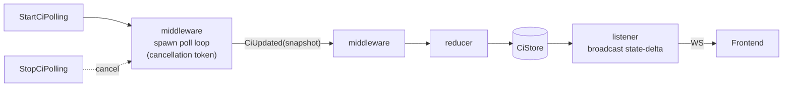
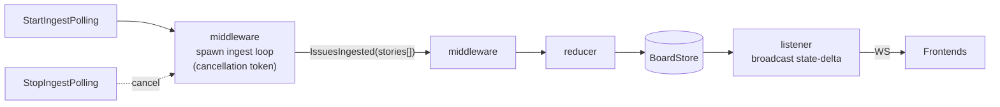
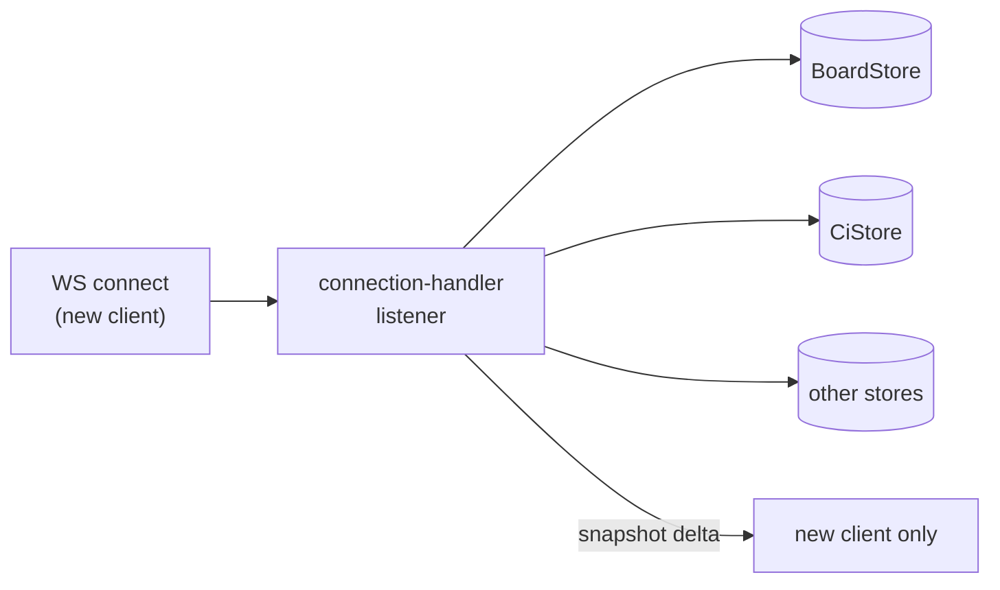
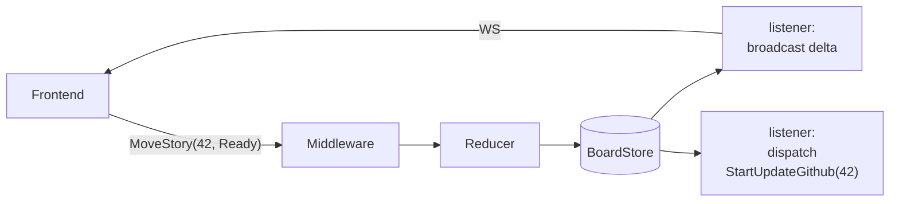
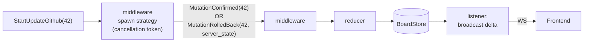
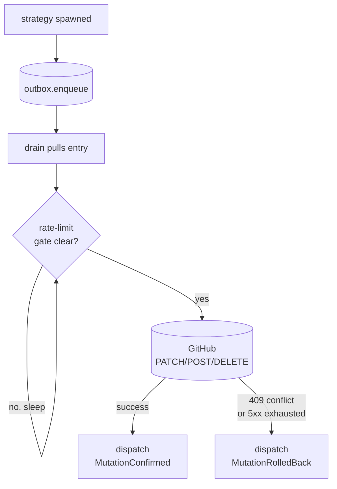

# WS-only state flow — concrete examples

Companion to [ws-only-state-flow.md](./ws-only-state-flow.md). Three illustrative flows: CI poll, board ingest (get issues), and issue update (mutation). Each follows the same `action → middleware → reducer → store → listener` shape, with different listeners doing the work.

## 1. CI state polling

Saga-style: a one-time `StartCiPolling` action spawns the long-running poll loop inside the middleware. The loop lives until a `StopCiPolling` action cancels it. Each fetch dispatches a `CiUpdated` action that flows back through the chain.

Notes:
- Server dispatches `StartCiPolling` once at startup. Tests / config-toggle / shutdown dispatch `StopCiPolling` to cancel cleanly.
- The polling middleware is the only place that touches GitHub for CI. Rate-limit gate (#1201) lives inside the loop — before each fetch, check the shared observer; if the wake epoch is in the future, sleep until it.
- `CiUpdated` carries success-snapshot OR failure shape. Failure updates `last_error` + `health` on a SyncStatus slice; reducer still fires.
- Idempotency: starting an already-running poll is a no-op. Stop without start is a no-op. Middleware tracks `HashMap<PollKind, CancellationToken>`.

## 2. Get issues (board ingest)

Two distinct flows. The periodic-ingest flow mirrors CI polling. The WS-connect-snapshot flow is a one-shot per-connection delivery — no polling, no actions, just a read.

### 2a. Periodic ingest (saga loop)

### 2b. WS-connect snapshot (per-connection, no actions)

Notes:
- 2a uses the same saga pattern as CI: `StartIngestPolling` once at startup, `StopIngestPolling` for cleanup.
- 2b fires per-connection on WS-connect. The handler reads CURRENT state from each store and sends a per-store snapshot delta to that connection only — not broadcast. After this initial send, subsequent deltas reach the client through the normal broadcast flow.
- Both share the rate-limit observer (#1201) — the ingest loop's GH fetch and any other GH-bound work consult one shared backoff state.
- `IssuesIngested` carries the full set; the reducer reconciles (add new, update existing, drop missing per a since-token).

## 3. Issue update (mutation)

User clicks "Move story 42 to Ready" → frontend dispatches; server applies optimistically; the update-github strategy follows; result loops back as a confirmation or rollback action. Architectural shape is identical to flows 1 + 2: a middleware-owned strategy handles external I/O; reducers stay pure; listeners broadcast or dispatch follow-ups.

### 3a. Optimistic path (user-visible)

User-visible work ends at the broadcast. The trigger listener fires the durability strategy.

### 3b. Update-github strategy (middleware-owned, same shape as 1 + 2)

Notes:
- Two listeners on the optimistic-path store change: broadcast (UI updates) and trigger (kicks off durability strategy). They run independently.
- Strategy middleware owns outbox + drain + retries + rate-limit awareness internally — those are persistence impl-details, not architectural shape. From the rest of the system's view, dispatching `StartUpdateGithub` is exactly like dispatching `StartCiPolling`: middleware handles it; result actions land back in the chain.
- `MutationConfirmed` clears any optimistic-pending flag in the reducer; `MutationRolledBack` reverts the store to the server's authoritative state. Each fires another broadcast so all clients converge.
- Conflict handling has no special path — rollback IS just another action through the same chain.

### 3c. Strategy internals (impl-detail, optional reading)

The update-github strategy's internal shape (hidden inside the middleware spawn):

Outbox is durable so a process restart resumes pending mutations. Drain handles ordering + retry policy + rate-limit awareness (#1201). Nothing here leaks into the architectural diagram — it's strategy-internal.

## Why all three look the same

Every external-I/O concern (CI polling, GitHub ingest, GitHub mutation) becomes a middleware-owned strategy started by a `Start*` action and stopped by a `Stop*` action. Strategies dispatch result actions back into the chain; reducers stay pure; listeners broadcast deltas or dispatch follow-ups. Persistence detail (outbox, drain, retries, rate-limit gate) lives inside each strategy — never in the architectural diagram.

Aligns with `feedback_middleware_owns_external_io` directly: only middleware does external I/O; agents read/mutate the store only.

New domains (reactions, pins, roster, sync-status) plug in by adding their own action types, reducer slice, and listeners — no new architecture.
