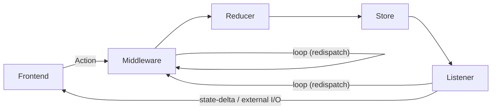

# WS-only state flow (exploratory)

**Status:** sketch — not adopted. Surfaced 2026-05-07 during diagnosis of #1205 r4 CI failures (real-backend.spec.ts reactions/pins races under workers=4 contention). Captures the proposed architectural shape: WebSocket as the **only** state channel between server and frontend, with REST POSTs replaced (or dual-tracked) by action-dispatch over the same WS.

## Why

Today's hybrid (REST GET for state, WS for "something changed" markers) has a load-sensitive race: frontend hooks fetch on mount; under contention WS connect lands AFTER mount; server broadcasts fired between mount and WS-connect are delivered to zero clients; frontend's mount-fetch may race the server's POST-handler write and miss the new state. Workers=1 cadence happens to never expose this; workers=4 (CI shard config) does.

Single-channel state delivery eliminates the race class: action ordering = state-delta ordering, and a new connection's first message can be the snapshot itself.

## Flow

Two loop-backs are the only branching: middleware can redispatch to the top of the chain, and listeners can redispatch new actions back to the middleware. Everything else is a straight line.

## Local store contents

Two slices on the frontend.

### Mirror slice (server-mirrored, reduce-only against WS state-deltas)

**Schema is rendered-domain, never raw GitHub idioms** — per `feedback_external_system_idiosyncrasies_at_boundary`, GH-vocabulary (label names, issue state strings, awaiting-team/awaiting-owner sub-state markers) translates into rendered-domain types AT the store boundary, not at the renderer. The store is the second anti-corruption line, not just the adapter. Today's #1192 retired-vs-accepted and #1197 awaiting-team-vs-awaiting-owner are exactly the leak class this rule prevents.

Mirror types (rendered-domain shapes):
- `board.stories[]` — `Story { number, title, state: StoryState, body?, assignees[], parent_epic?, ... }` where `StoryState` is a sealed union (`Icebox | Ready | InProgress | DeskCheck | Delivered | AwaitingOwner | AwaitingTeam | Accepted | Rejected | NeedsFixes`), not a label string
- `reactions` — `AggregatedReaction[]` per channel × message_key
- `pins` — `PinnedMessage[]` per channel
- `ci` — `CiSnapshot { state: CiState, run_id, sha, title }` where `CiState` is `Green | Red | Running | QuotaExhausted | Unknown`
- `roster` — `RosterMember { name, role, presence: Online | Busy | Away | Offline }`
- `messages` — `ChatMessage[]` per channel
- `sync-status` — `SyncStatus { pending: number, last_error?, health: Healthy | Recovering }`

### Local-only slice (owned by frontend, never crosses WS)

Two lifetimes per `feedback_session_vs_persistent_state` — encode the axis at the type level so the silent-restore-bug class can't recur.

**Persistent (survives reload, written to localStorage / userData):**
- UI prefs (filter pills active set, sidebar section collapsed map, theme)
- composition draft buffer (current channel × text, attachments — survives accidental reload)

**Ephemeral (session-scoped, in-memory only):**
- scroll position per channel
- focused channel
- search query
- drill-in open + target story
- reaction-picker target message
- WS connection status (connected / connecting / offline) — derived from adapter

## WS-offline UX

When the WS adapter reports `offline`, the frontend stays interactive against the cached mirror — per `feedback_collaboration_visibility_inviolable` we never block typing or hide chat while a surface is visible. Concrete shape:

- Mirror state (board, messages, reactions, pins, ci, roster) stays rendered as last-seen.
- A non-modal overlay surfaces "Connecting…" / "Offline — N pending actions" with reconnect status.
- Composition buffer stays writable; queued actions accumulate locally.
- On reconnect, server snapshot lands as a delta and supersedes the cached mirror; queued local actions dispatch in order.
- Conflict-on-reconnect (server's snapshot disagrees with locally-queued mutations) surfaces as a "Recovering" state-delta from the sync-status mirror — same shape as drain conflicts today.

Read-only / dim-and-disable shapes are explicitly rejected: they break the visibility rule.

## Key invariants

- Frontend never reads via REST. Only WS.
- Server is the single source of truth. Frontend stores are mirrors.
- Action ordering = state-delta ordering (same channel).
- New connection: server pushes the current state snapshot as the first delta; thereafter only deltas.
- External I/O (GH) lives in middleware, not in reducers or subscribers.
- MCP queries + TUI subscribe to the same WS state stream — one substrate, every consumer is equal.

## Middleware vs reducer vs listener — separation of concerns

Each stage owns exactly one responsibility:

- **Middleware** — pure transforms over actions. Validates shape, normalizes payload, logs. May short-circuit (drop invalid action) or redispatch a derived action to the top of the chain. Never touches store state. Never does I/O.
- **Reducer** — pure `(Action, State) → State'`. Synchronously applies an action to the relevant store. No side effects.
- **Listener** — subscribes to specific actions or store changes; runs side effects after the reducer fires. Side effects include:
  - Broadcasting state-deltas over WS to subscribers (frontend mirror updates, TUI, MCP).
  - Enqueuing into the outbox for durable replay (GH-bound mutations).
  - Doing external I/O directly when no replay is needed (e.g., diag-log writes).
  - Dispatching follow-up actions back into the orchestrator (loop to top of middleware) — e.g., on drain conflict, dispatch `MutationRolledBack` so the reducer reverses the optimistic state.

This separation makes optimistic-update natural: reducer applies the user's action immediately; the broadcast listener fires; UI updates everywhere. The outbox listener enqueues; drain loop runs async; on confirmation or conflict, drain dispatches a confirmation/rollback action that loops through the middleware chain back into the reducer.

GH-bound action types (outbox listener fires): `StateTransitioned`, `TagAdded`, `TagRemoved`, `StoryClosed`, `FreeCommentAppended`, `GateCommentAppended`.

Local-only action types (no outbox listener): UI prefs, query observations, sync-status updates, broadcast-only signals.

## What this fixes

- The race that drove #1205 r4 CI failures (reactions/pins flaky under workers=4): frontend hook fetch on mount races the server broadcast.
- The implicit-state-skip class around delivered/awaiting-team transitions where one observation tool's schema lags another (today's #1197 PASS-flip-flop driven by bridge `get_story` schema gap on awaiting-owner sub-state — same surface, separate substrate-bug to file).
- The duplicate state-management surface (REST handler shape vs WS marker shape vs renderer hook shape — three places to keep in sync per state type).

## What this doesn't fix (orthogonal)

- GH rate-limit cooldown amplification (#1201 — shared rate-limit gate, separate work).
- Pre-push hook flake-class (#1206 — workers=3 × 6 shards spawn 18 concurrent Electron processes that crash each other under contention).

## Migration shape (rough, not a plan)

1. Extend SyncOrchestrator to accept Actions over the WS adapter (today: REST handlers).
2. Introduce ReactionsStore + PinsStore + CiStore + RosterStore as siblings of BoardStore (some already exist as ad-hoc state).
3. Add subscriber → broadcast plumbing per store (BoardStore already has it).
4. On each WS connect, server pushes per-subscription snapshot as the first delta.
5. Frontend hooks (useReactions, usePins, useCiGlyph, useTeamRoster, useBoardStore) reduce against WS state-deltas instead of REST GETs.
6. REST GET handlers retire as their renderer consumers migrate; POST handlers stay until WS-RPC for actions ships.
7. MCP subscribers swap to WS state stream — single substrate.

Each store is independently migratable; the BoardStore migration is the canonical archetype that the others replicate.
