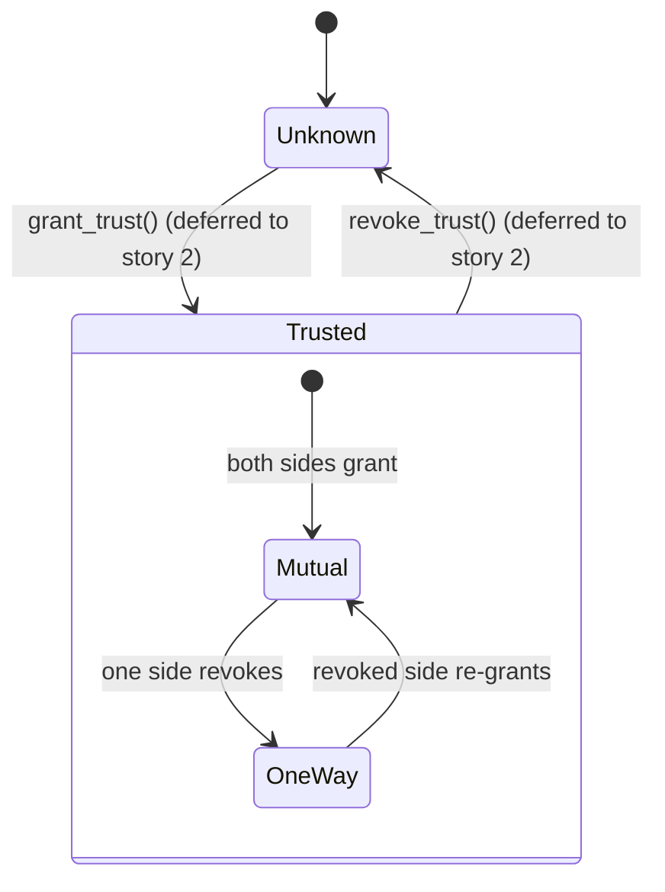
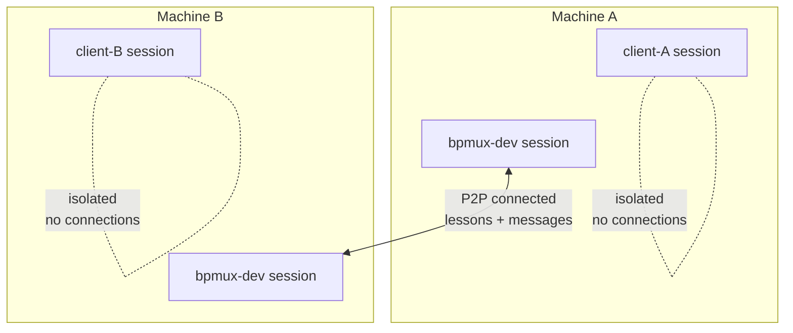

# P2P Security Architecture

*Designer + PM + Dev — 2026-04-10. Based on battleship trust model and team discussion.*

## Status

**Phase 1 ships connect + presence only.** The trust authorization layer described in this document is the TARGET architecture, not the current state. See each section for "Phase 1 reality" callouts that distinguish target from implementation.

- 🚫 **Not in the code**: the entire direct-p2p transport staging (WebRTC peer connection, data channels, SDP encryption) is retired as unreachable — recover from git (parents of `aea2b11b` / this commit); multi-instance today runs chat-only through the server
- ⏸ **Deferred to story 2** (shape TBD, awaiting real-world usage data): trust state field, grant/revoke, data-flow gating by trust
- 📦 **Icebox**: hot-reload resilience, agent sandboxing, visualization layer

## Trust State Machine

```
         grant()
    ┌──────────────►┐
    │               │
┌───┴───┐     ┌─────┴───┐
│Unknown │     │ Trusted  │
│(default)│     │  (★)    │
└───┬───┘     └─────┬───┘
    │               │
    └──────────────◄┘
         revoke()
```

Both peers must independently grant trust. Trust is bidirectional:
- `trusted` = I trust them
- `trustsMe` = they trust me
- Data flows only when BOTH are true

> **Phase 1 reality**: no trust state exists in code. Possession of the shared passphrase authenticates the WebRTC connection, nothing more. Once connected, data flows unconditionally. The state machine above is the target we will grow into once we have real usage data to inform the shape (bool vs enum vs per-resource vs graded).

## Session Isolation

```
┌─ Machine A (Ryan's MacBook) ───────────────────────┐
│                                                     │
│  ┌─ bpmux-dev ──────┐    ┌─ client-A ──────┐      │
│  │ lessons.json      │    │ lessons.json     │      │
│  │ messages.jsonl    │    │ messages.jsonl   │      │
│  │ board.json        │    │ board.json       │      │
│  └────────┬──────────┘    └──────────────────┘      │
│           │ P2P                 (no connections)    │
└───────────┼─────────────────────────────────────────┘
            │
            │ encrypted data channel
            │
┌───────────┼─────────────────────────────────────────┐
│           │                                          │
│  ┌────────┴──────────┐    ┌─ client-B ──────┐      │
│  │ bpmux-dev (peer)  │    │ lessons.json     │      │
│  │ lessons.json      │    │ messages.jsonl   │      │
│  │ messages.jsonl    │    │ board.json       │      │
│  └───────────────────┘    └──────────────────┘      │
│                                 (no connections)    │
│  Machine B (New MacBook) ───────────────────────────│
└─────────────────────────────────────────────────────┘
```

Key: P2P connects SESSIONS, not machines. client-A and client-B have no connections — isolated by default.

> **Phase 1 reality**: implemented and working. Each project directory is its own session with its own storage. A session only has peers if it has explicitly run `/session` or `/join`.

## Data Flow

```
┌──────────────┐                    ┌──────────────┐
│  Session A   │   connected        │  Session B   │
│              │                    │              │
│  lessons ────┼──────────────────►─┼── queryable  │
│  messages ───┼──────────────────►─┼── relayed    │
│  board ──────┼───── NOT shared ──►│              │
│  files ──────┼───── NOT shared ──►│              │
│              │                    │              │
└──────────────┘                    └──────────────┘
```

What flows between connected peers:
- ✓ Lessons (queryable, not auto-merged)
- ✓ Messages (relayed bidirectionally)
- ✗ Board state (session-specific, not shared)
- ✗ Files (no filesystem pass-through)
- ✗ Agent permissions (local to each machine)

> **Phase 1 reality**: data flows whenever the data channel is open. There is no trust gate. The target diagram had "trust granted" on the arrows — that label has been removed because it would be misleading today. In Phase 1 the passphrase exchange IS the authorization and nothing downstream re-checks it.

## Connection Flow (Sequence)

```
Machine A                           Machine B
    │                                   │
    │  /session                         │
    │  ──────► generate offer           │
    │          + passphrase             │
    │                                   │
    │  share passphrase + code          │
    │  ─────────────────────────────►   │
    │                                   │  /join
    │                                   │  ──────► decode offer
    │          answer code              │          generate answer
    │  ◄─────────────────────────────   │
    │                                   │
    │  /accept                          │
    │  ──────► establish                │
    │          data channel             │
    │                                   │
    │  ◄── Hello (name, session_id) ──► │
    │                                   │
    │  ◄── encrypted data channel ───►  │
    │       lessons + messages          │
    │                                   │
    │   ... on disconnect ...           │
    │  ◄── "<name> left" broadcast ──   │
    │                                   │
```

> **Phase 1 reality**: matches what ships. The `grant_trust()` calls shown in earlier drafts of this doc have been removed — they do not exist in code. The Hello exchange (naming) and disconnect propagation are the only additions beyond raw connection.

## Five Security Layers

```
┌─────────────────────────────────────────┐
│  Layer 5: Visualization           📦 icebox
│  User sees trust state, connections,     │
│  isolation boundaries at a glance        │
├─────────────────────────────────────────┤
│  Layer 4: Agent Sandboxing (nono) 📦 icebox
│  OS-level: agents restricted to          │
│  project directory, allowlisted network  │
├─────────────────────────────────────────┤
│  Layer 3: Trust Authorization     ⏸ deferred to story 2
│  Bidirectional grant/revoke per peer     │
│  No trust = no data flow                 │
├─────────────────────────────────────────┤
│  Layer 2: Session Isolation       ✅ implemented
│  Each project = separate session         │
│  P2P connects sessions, not machines     │
├─────────────────────────────────────────┤
│  Layer 1: Connection Encryption   ✅ implemented
│  WebRTC DTLS + SDP encryption            │
│  (PBKDF2 → AES-256-GCM)                  │
└─────────────────────────────────────────┘
```

> **Phase 1 reality**: layers 1 and 2 are the entire security posture today. Layer 3 exists only in this document — deferred to story 2 while the team gathers usage data on what shape trust actually needs (bool vs enum vs per-resource vs graded). Layers 4 and 5 are icebox.

## Why trust is deferred

The team debated two trust models before deferring:
- **(a) passphrase-as-trust** — possession of the shared passphrase IS the trust decision. No separate state. Simple, but collapses "connected" and "trusted" into one variable, making revoke equivalent to disconnect.
- **(c) trust state wired day one, auto-granted on handshake** — `trusted: bool` on peer state, gate on data flow, auto-grant on successful handshake. Same Phase 1 UX as (a), preserves the connected ≠ trusted distinction for Phase 2.

Both options locked in a specific shape (binary, per-peer) before anyone had used the feature. The battleship prior art suggests trust may need to be richer (per-resource, graded, introductions / web of trust). Rather than guess the shape, the team deferred story 2 and is gathering connect/disconnect telemetry to inform the spec.

**The rule**: story 2 will be shaped when real usage teaches us what trust needs to do, not before.

## Mermaid (for GitHub rendering)




