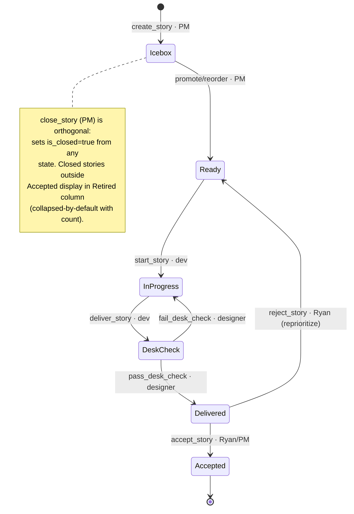

# Process State Machine

**The board IS the state machine.** Stories move between board columns
as gate-tools fire; each transition is a directed handoff to the next
role. This doc captures the team's shared understanding of the
process for discussion.

This complements `handoff-process.md` (which describes the
communication-shape of handoffs).

## Diagram



## Board Columns

The board has **7 columns** (6 active + 1 retired-archive). Each column
maps 1:1 to a state, except the Retired column which is the
`is_closed=true && state != Accepted` projection.

| Column | State | Owner-lane | Meaning |
|---|---|---|---|
| ICEBOX | Icebox | PM | Filed but not prioritized |
| READY | Ready | dev pickup queue (PM owns ordering) | Priority-ordered. Dev claims **top of queue** — never asks "what next", never chooses. PM owns ordering via `reorder_story`; the queue order IS the answer. Reject-from-acceptance stories land here and PM reprioritizes them in line. Rework-context surfaces as ↩ glyph (derived from transition history). |
| IN PROGRESS | InProgress | dev | Claimed (WIP-1). Reject-from-desk-check stories live here for rework. Rework-context surfaces as ↩ glyph (derived from transition history). |
| DESK CHECK | DeskCheck | designer | Dev fired `deliver_story`; awaiting designer review |
| DELIVERED | Delivered | PM / Ryan | Designer passed; awaiting acceptance |
| ACCEPTED | Accepted | (terminal) | User-story satisfied; story closed |
| RETIRED | (`is_closed=true` from non-Accepted state) | (archive) | Collapsed-by-default with count visible (e.g., "Retired (19) ▸"); expand-on-click. PM-fired `close_story` for dedup/won't-fix/retire decisions; preserves audit-trail without polluting Accepted's success-narrative. |

## States

Six states (1:1 with active columns; labels match state-names 1:1):

| State | Label |
|---|---|
| Icebox | `icebox` |
| Ready | `ready` |
| InProgress | `in-progress` |
| DeskCheck | `desk-check` |
| Delivered | `delivered` |
| Accepted | `accepted` |

## Two User-Classes

bpmux has **two types of users**, both first-class:

1. **Owner-user** — Ryan (human owner of the product)
2. **Agent-user** — AI agents (dev, designer, PM, and any other agents that interact with bpmux)

Per `feedback_agents_are_users_not_infrastructure`: agents are users of bpmux, not infrastructure. Their needs file as Features/Bugs against the product just like Ryan's do.

Stories carry a **user-class** indicating who the user is for that story:

| User-class | Acceptance | Examples |
|---|---|---|
| Owner-user-class | Ryan accepts (live walk) | UX features for Ryan's mental-model; visible affordance changes; user-facing surfaces |
| Agent-user-class | PM accepts (agent-proxy) | MCP tool affordances for agents; CI-signal mechanics; substrate that agents consume |

User-class is **orthogonal to story-class** (Feature/Bug/Chore — see below). A Feature might be owner-user-class (UX feature for Ryan) or agent-user-class (new MCP tool for agents). A Bug can be either user-class. Chores typically have no user (substrate-only) and PM accepts.

Surfaced via `user-class:owner` / `user-class:agent` label at filing-time so accept-routing is visible at the column-surface (Delivered column).

## Story Classes

Three classes, distinguishable on the user-axis:

- **Feature** = NEW user-job. Introduces a new affordance the user can do that didn't exist. Positive work.
- **Bug** = a user-visible defect in **previously-accepted** functionality. Existing affordance malfunctions or diverges from expected behavior. Corrective work on shipped product.
- **Chore** = **negative work**. Pays down tech debt; goes back on a decision that didn't pay off; makes the codebase a better place to work. No meaningful difference to the end-user.

The temporal axis distinguishes Bug from rework:
- Pre-acceptance defect (story still InProgress / DeskCheck / Delivered) → **rework** via `fail_desk_check` or `reject_story`. Not a Bug.
- Post-acceptance defect (functionality previously accepted, now observed broken) → **Bug**. File new story.

The "would-I-file-a-bug?" test at desk-check / acceptance: if the answer is yes, that bug IS the rejection reason — fail/reject, don't accept-and-file-bug-as-deferral.

## Gate Tools

Each gate-tool appends a transition `(from, to, actor, timestamp,
comment)` to the story's transition log via
`BoardEvent::StateTransitioned` + `BoardEvent::GateCommentAppended`.
Labels reflect current state 1:1.

| Tool | From | To | Fired by | Premise required |
|---|---|---|---|---|
| `create_story` | ∅ | Icebox | PM | user_job + observation_falsifier + ATP path |
| `start_story` | Ready | InProgress | dev | pickup_paraphrase + falsifier_reframing |
| `deliver_story` | InProgress | DeskCheck | dev | verified_observation |
| `pass_desk_check` | DeskCheck | Delivered | designer | source-grounded + live-verify (CI green + observable behavior) |
| `fail_desk_check` | DeskCheck | InProgress | designer | rejection reason (recorded in gate-comment audit-trail) |
| `accept_story` | Delivered | Accepted | Ryan (owner-user-class stories) / PM (agent-user-class stories) — see Two User-Classes below | quality audit + CI green + user-story satisfied |
| `reject_story` | Delivered | Ready | Ryan | rejection reason (recorded in gate-comment audit-trail) |
| `close_story` | (any) | (`is_closed=true`; state preserved) | PM | retire/dedupe reason |

## Transition History (audit-trail)

A story carries two pieces of state:

- **`current_state`** — one of the 6 (Icebox / Ready / InProgress / DeskCheck / Delivered / Accepted)
- **`transitions`** — an ordered list of `(from, to, actor, timestamp, comment)` tuples

That's it. Everything else is projection.

The transition list IS the audit-trail. There is no separate "Rejected"
or "NeedsFixes" anything in the data model — a rejection is just a
backward transition (e.g., `Delivered → Ready` or `DeskCheck →
InProgress`), with the reason stored as the `comment` on that
transition. Forward transitions don't typically carry a reason
(except premise text like `verified_observation`).

Substrate today: `BoardEvent::StateTransitioned` (the transition log)
+ `BoardEvent::GateCommentAppended` (the per-transition comment).

### Rework surface (board overview)

A **↩ glyph** appears on Ready / InProgress stories whose most-recent
transition is backward — i.e., `Delivered → Ready` (came back from
acceptance) or `DeskCheck → InProgress` (came back from desk-check) —
and where no later forward transition has superseded it.

Pure projection over the transition history; no persistent
rework-state needed. Hover/tooltip exposes the comment from that
backward transition.

Without this surface, PM/dev lose the distinction at the column where
action happens (per `feedback_nothing_hidden_from_owner`).

### Rejection-reason surfacing (story view, dev-facing)

When dev reads a rework story (via `get_story`), the story body is
**enriched at the top** with a "## Rework context" section showing
the comment from the most-recent backward transition. Dev sees the
reason as part of pickup context — no history scan needed.

This is the substrate's load-bearing UX promise: dev shouldn't dig
through a transition log to figure out what to fix. The most recent
rejection comment is surfaced directly on the story body when read,
and clears (substrate-side: stops being included) once the story has
moved forward again.

The trigger is "most-recent transition is backward edge with no later
forward transition." Pure projection over the transition log.

### Why no separate "Rejected" thing

Earlier drafts of this doc proposed a separate `Rejected` state,
`Rejected` label, and `Gate::Rejected` event-type — all carrying
the same information. Owner catch (2026-05-02): the transition itself
encodes the rejection. Adding a named "rejected" anywhere is
field-overloading the audit-trail across multiple substrates,
violating single-source-of-truth.

## The Five Gates (premise-before-verdict)

Each board-column transition corresponds to a logical gate with
lane-specific verification:

1. **Filing gate** (`create_story`, PM-lane) — filing-time AC framed
   as observation-falsifier ("I would reject if I observed X").
   Designer participates on shape; PM runs pre-filing-audit subagent
   for dup-check before the create_story fires.
2. **Pickup gate** (`start_story`, dev-lane) — dev paraphrases
   user-job + reframes the falsifier in their own words. WIP-1
   strict. **Dev claims top-of-ready without consultation** — the
   queue's priority order IS the answer to "what's next"; dev never
   asks PM. PM owns the ordering and reorders via `reorder_story`.
3. **Pre-delivery gate** (no state-change; happens within InProgress)
   — pre-commit hook (fmt + clippy + nextest + npm:unit + cargo
   audit) **structurally** blocks broken-test landings (substrate, not
   discipline). Story-scope = commit-scope; multi-slice stories ship
   as a chain under one InProgress span (single deliver_story at the
   end). Debt visible in commit body.
4. **Desk-check gate** (`pass_desk_check` / `fail_desk_check`,
   designer-lane) — pre-walk source-grounding then live-verify;
   local-vs-global verification ladder (substrate emission ≠ proof;
   walk the full cascade); CI green precondition.
5. **Acceptance gate** (`accept_story` / `reject_story`) — quality
   audit + user-story-satisfied check + CI green. Routing per
   user-class (above): **owner-user-class stories → Ryan accepts**
   (live walk); **agent-user-class stories → PM accepts** (agent-proxy).
   Falsifier: if you would file a bug about the implementation,
   that bug IS the rejection reason — reject, don't accept-and-defer.

## Cross-cutting Disciplines

These apply across every transition, not at any one specific gate:

- **CI green is a gate precondition** (rule) — pre-deliver, pre-desk-check,
  pre-accept all call `get_ci_state`; red CI blocks regardless of
  root cause. **Bridge-stale-deliver-with-citation** (exception below)
  applies only when live-verify is empirically *unreachable*
  (rate-limit-blocked, network-unavailable), not when CI is *red*.
- **WIP-1 strict** — one InProgress per dev role; no parallel pickup.
- **Story-scope = commit-scope** — one commit, one story (or one
  sub-slice of a multi-commit story); honest-bundled fails desk-check.
- **External catch over self-catch** — structural / typed / peer
  catches are load-bearing; self-rules drift. Pre-commit hook is the
  exemplar at substrate-layer.
- **Owner mental-model first-class** — owner familiarity compounds;
  outweighs on-paper technical wins at substrate-decisions.
- **Bridge-stale-deliver-with-citation** (exception to CI-green-precondition) —
  when live-verify is rate-limit-blocked or otherwise unreachable
  (NOT when CI is red), fire the gate with citation + reversibility
  commitment; do not indefinitely hold for an unreachable check.
- **Verify-tool-output-schema-grounding** — before claiming
  substrate-failure based on a verification tool's output, source-
  ground the tool's serialization code; field-overloading is the trap.
- **Filing-cadence vs rate-limit substrate** — burst-fire mutations
  re-trigger secondary rate-limit. Pace with verify-pauses so backoff
  stays at the 60s base.
- **Ready queue is priority-ordered; dev claims top without consultation** —
  PM maintains the queue order continuously via `reorder_story`; dev
  pulls position-1 via `start_story`. No "what should I work on?"
  question; the queue order IS the answer.
- **Audit substrate** — the per-story transition list is the
  audit-trail. `BoardEvent::StateTransitioned` (the transition) +
  `BoardEvent::GateCommentAppended` (the per-transition reason)
  together make the log queryable via `view_story_timeline`. The log
  is the single-source-of-truth for "what happened to this story";
  every other surface (rework glyph, story-body enrichment, etc.) is
  a projection.
- **Cross-story coupling / family-of-specs** — sister-classes tracked
  via the "Sister-class to" body field; helps avoid orphaned-story
  pain and lets dev see why sibling work matters.
- **Nothing hidden from owner** — channels/filters/scope selections
  emphasize or dim but never hide; hiding requires explicit owner
  opt-in (per `feedback_nothing_hidden_from_owner`). The Retired
  column's collapsed-by-default-with-count satisfies this — visible
  at headline level, expand-on-scope-control.
- **Don't endeavor to make chores** — pay debt at-sight in current
  commit when small/safe; per `feedback_five_team_principles`
  see-debt-pay-debt. Chores are for substrate work whose scope
  warrants its own story (test infra changes, dead-code removal,
  vestigial-substrate retire, dependency hygiene). Speculative
  "we should clean this up someday" without a specific
  substrate-pain fails YAGNI.
- **Hurry is a debt-symptom** — when the team feels hurried, that's
  diagnostic of upstream tech-debt compounding. Audit the debt,
  don't shortcut discipline. Per `feedback_hurry_is_debt_symptom`:
  defer-debt → debt compounds → hurry → more deferral → more debt
  spiral. Don't accommodate the hurry-feel; investigate the cause.
- **Chore-bloat is decision-symptom** — when chore-volume grows large
  enough to displace business-value, that's diagnostic of upstream
  decisions that didn't pay off (premature substrate, accumulated
  cut-corners, hurried-shipping). Per
  `feedback_chore_bloat_as_decision_symptom`: audit upstream cause
  rather than scheduling chore-iterations.
- **Bug-question test at desk-check/acceptance** — moment-of-action
  self-check: "would I file a bug about this if I passed/accepted
  it?" → if yes, fail/reject; the bug-I-would-file IS the rejection
  reason. Per `feedback_bug_question_test_at_desk_check`. Closes
  the accept-and-file-bug deferral anti-pattern.
- **Subagent-discipline as substrate** — the team's pre-flight
  subagents (per role: pre-filing-audit, desk-check-reviewer,
  surface-concreteness-checker, multi-commit-reviewer, debt-at-sight-scan,
  pre-commit-review, etc.) ARE the structural external-catch
  substrate. Inline-shortcut bias bypasses them with the same reflex
  that creates apply-gaps. Per `feedback_default_to_inline_bypasses_subagent_discipline`:
  spawn the relevant subagent at gate-tool fire-time; don't
  re-derive the verification from memory.

## Iterations

- Iterations open when Ryan convenes; close at session end.
- Scope committed at open.
- Iteration-close ritual: 5–7 min promotion-audit per role
  (4-question framework); ≥2-arc rule for lesson promotion; arcs
  must be time-separated (study + same-session audit ≠ genuine
  arcs).

## Memory Chain

The team's knowledge accumulates through a four-layer chain:

```
arcs (incidents/conversations)
  → lessons (per-role .md files in ~/.claude/projects/.../memory/)
  → principles (durable identity statements)
  → values (root)
```

See `memory-architecture.md` for the full chain semantics, storage
layers, and arc-gathering methods.
